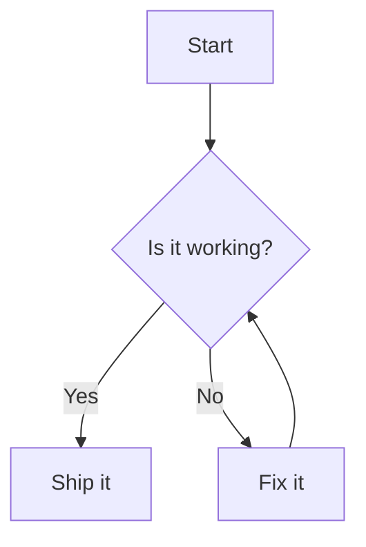

# dumi-plugin-mermaid

> 把 `mermaid` 代码块渲染成图表。

## Usage

### Install

> 前置条件：dumi@2.0.0+

```bash
npm install dumi-plugin-mermaid --save-dev
# yarn add dumi-plugin-mermaid --dev
# pnpm add dumi-plugin-mermaid --save-dev
# bun add dumi-plugin-mermaid --dev
```

### Apply

```ts
// .dumirc.ts
export default {
  plugins: ['dumi-plugin-mermaid'],
};
```

### Example

<pre lang="markdown">

</pre>

### Options

dumi 的 `plugins` 只接受字符串，需要传选项时用一个本地插件文件包一层：

```ts
// .dumi/mermaid-plugin.ts
import { defineMermaidPlugin } from 'dumi-plugin-mermaid';

export default defineMermaidPlugin({
  mermaidConfig: { securityLevel: 'loose' },
});
```

```ts
// .dumirc.ts
export default {
  plugins: ['./.dumi/mermaid-plugin.ts'],
};
```

`mermaidConfig` 会作为 `mermaid.initialize` 的参数，必须是可序列化的 JSON。

`defaultView` 指定图表面板默认展示的视图（`'preview'` | `'code'`，默认 `preview`）。设为 `'code'` 时首屏只渲染源码，点 Preview 才会加载并渲染 mermaid：

```ts
// .dumi/mermaid-plugin.ts
export default defineMermaidPlugin({ defaultView: 'code' });
```

### Bundle Size

mermaid 以 `import('mermaid')` 懒加载，并等图表滚动到视口附近（提前一屏）才开始渲染：没有图表的页面不下载 mermaid，首屏外的图表也不会阻塞首屏。

如果连站点产物里的 mermaid 也不想保留，可以让浏览器直接从 CDN 加载：

```ts
// .dumi/mermaid-plugin.ts
import { defineMermaidPlugin } from 'dumi-plugin-mermaid';

export default defineMermaidPlugin({
  runtimeURL: 'https://unpkg.com/mermaid@11/dist/mermaid.esm.min.mjs',
});
```

`runtimeURL` 必须指向 mermaid 的 ESM 入口（`dist/mermaid.esm.min.mjs`），它会继续按图类型懒加载。
地址在构建期注入一次，不会写进每个图表的 props。除绝对地址外，也支持 `//cdn.example.com/...` 和站内路径
（如 `/mermaid.esm.min.mjs`，把文件放进 `public/` 即可自托管）。

CDN 模式会引入外网依赖，内网 / 离线环境请勿开启；`http://` 地址在 https 站点会被浏览器拦截，构建时会给出警告。
版本由地址里的 `@11` 决定，不会与插件依赖中的 mermaid 版本联动。

几个渲染细节：

- `defaultView: 'code'` 时，鼠标悬停或聚焦到切换按钮会预先下载 mermaid，点开 Preview 即出图；
- 加载失败会自动重试一次，仍失败时展示源码与错误信息，并提供「重试」按钮；
- 同一份源码再次渲染时，骨架会先占住上次的高度，避免页面内容跳动；
- 单个图表需要立即渲染（如整页打印）时，给组件传 `eager`。

### Full Document

Read more: https://wxh16144.github.io/dumi-plugin-mermaid/
