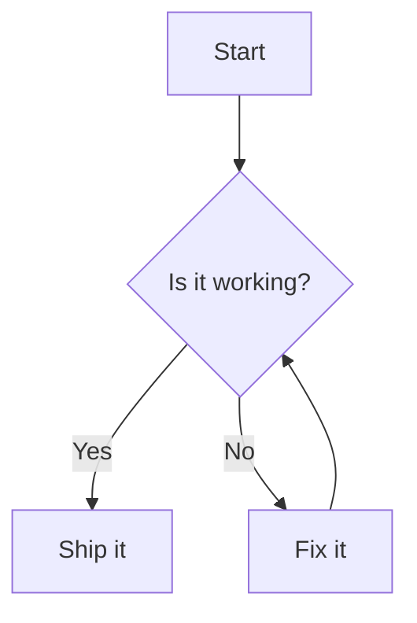

## 渲染 Mermaid 图表 <sub>借鉴 [rehype-mermaid](https://github.com/remcohaszing/rehype-mermaid)，并为 dumi 做了适配</sub>

用 `mermaid` 代码块书写图表：

````md

````

会被渲染为图表：


## 快速开始 {#quick-start}

```bash
npm install dumi-plugin-mermaid --save-dev
```

```ts | pure
// .dumirc.ts
export default {
  plugins: ['dumi-plugin-mermaid'],
};
```

需要传选项时，用本地插件文件包一层 `defineMermaidPlugin`，详见 [配置](/usage#config)。

---

## 交互控件 {#viewer}

默认渲染不带控件。装上 `dumi-plugin-mermaid/viewer` 即可放大、复制、平移缩放；
节点带链接时可以点击跳转（拖动不会误触）：

### 插件家族

<code src="./demos/home-viewer.tsx" inline></code>

<i>图中是作者同系列的 dumi 插件，本站对应「图表」。全站开启方式见 [Advanced](/advanced#site-wide)。</i>

## 能力 {#features}

| 能力     | 说明                                                                |
| -------- | ------------------------------------------------------------------- |
| 代码块   | 使用 `mermaid` 标记，写 Markdown 即可                               |
| 主题     | 跟随 dumi 明暗配色（`data-prefers-color` / `prefers-color-scheme`） |
| 懒加载   | 图表进入视口前一屏才下载并渲染 mermaid，没有图表的页面不下载        |
| 初始化项 | 通过 `mermaidConfig` 透传给 `mermaid.initialize`                    |
| 源码切换 | 默认带「预览 / 源码」面板，支持左右方向键切换                       |
| 可选控件 | 放大 / 复制 / 平移缩放，装在 `/viewer` 子路径，不引入不进产物       |

## 导出 {#exports}

| 入口                            | 内容                                                     |
| ------------------------------- | -------------------------------------------------------- |
| `dumi-plugin-mermaid`           | dumi 插件（默认导出）与 `defineMermaidPlugin`            |
| `dumi-plugin-mermaid/component` | 组件与 Hook：`Mermaid`、`MermaidToggle`、`useMermaid` 等 |
| `dumi-plugin-mermaid/viewer`    | 带交互控件的 `MermaidViewer`，默认导出保留源码切换       |

`dumi-plugin-mermaid/mermaid-loader` 由插件在构建期自动 alias，无需手动引入。

## 下一步 {#next}

- [Usage](/usage#config)：全部配置项、CDN 模式与体积优化
- [Examples](/example)：各类 Mermaid 图表的渲染效果
- [Advanced](/advanced#site-wide)：交互控件、本地主题与多语言
