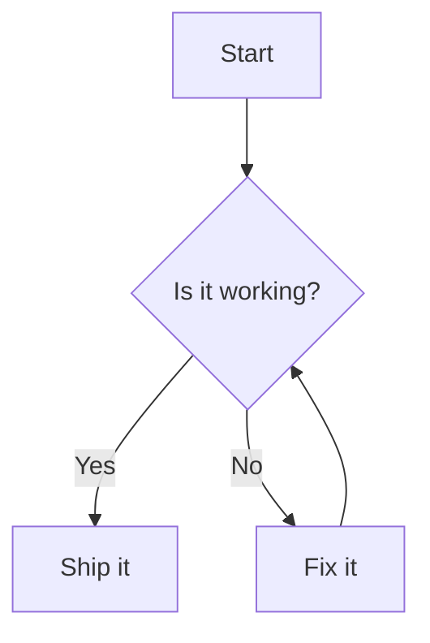

## 安装 {#install}

> 前置条件：dumi@2.0.0+

:::code-group

```bash [npm]
npm install dumi-plugin-mermaid --save-dev
```

```bash [yarn]
yarn add dumi-plugin-mermaid --dev
```

```bash [pnpm]
pnpm add dumi-plugin-mermaid --save-dev
```

```bash [bun]
bun add dumi-plugin-mermaid --dev
```

:::

<br />

## 使用 {#apply}

```js {3} | pure
// .dumirc.ts
export default {
  plugins: ['dumi-plugin-mermaid'],
};
```

然后在 Markdown 里用 `mermaid` 代码块书写图表：

<pre lang="markdown">

</pre>

## 配置 {#config}

dumi 的 `plugins` 只接受字符串，需要传选项时用一个本地插件文件包一层：

```js | pure
// .dumi/mermaid-plugin.ts
import { defineMermaidPlugin } from 'dumi-plugin-mermaid';

export default defineMermaidPlugin({
  mermaidConfig: { securityLevel: 'loose' },
});
```

```js {5} | pure
// .dumirc.ts
import { resolve } from 'path';

export default {
  plugins: [resolve(__dirname, './.dumi/mermaid-plugin.ts')],
};
```

> 相对路径以项目根目录为基准，不是 `.dumirc.ts` 所在位置；两者不同层时用 `resolve(__dirname, ...)`。

`mermaidConfig` 会作为 `mermaid.initialize` 的参数，**必须是可序列化的 JSON**。

`defaultView` 指定图表面板默认展示的视图，可选 `'preview'`（默认）或 `'code'`：

```js | pure
// .dumi/mermaid-plugin.ts
export default defineMermaidPlugin({ defaultView: 'code' });
```

设为 `'code'` 时首屏只渲染源码，点预览才加载 mermaid。

`component` 替换渲染图表的组件，默认是内置的「预览 / 源码」面板。开启交互控件时指向 viewer 子路径：

```js {2} | pure
// .dumi/mermaid-plugin.ts
export default defineMermaidPlugin({ component: 'dumi-plugin-mermaid/viewer' });
```

也支持相对 / 绝对路径指向自己的组件，组件会收到 `code`、`mermaidConfig`、`defaultView`。

详见 [Advanced](/advanced#site-wide)。

## 体积 {#size}

mermaid 懒加载，图表进入视口前一屏才下载：

- 没有图表的页面不下载 mermaid；
- 首屏外的图表滚动到附近才加载，多个图表依次渲染。

不想把 mermaid 打进产物时，改从 CDN 加载：

```js | pure
// .dumi/mermaid-plugin.ts
import { defineMermaidPlugin } from 'dumi-plugin-mermaid';

export default defineMermaidPlugin({
  runtimeURL: 'https://unpkg.com/mermaid@11/dist/mermaid.esm.min.mjs',
});
```

必须指向 **ESM 入口**（`dist/mermaid.esm.min.mjs`），指向 UMD 产物会加载失败。
支持绝对地址、协议相对地址（`//cdn.example.com/...`）和站内路径（`/mermaid.esm.min.mjs`，文件放 `public/`）。

常用地址：

| 源        | 地址                                                                       |
| --------- | -------------------------------------------------------------------------- |
| unpkg     | `https://unpkg.com/mermaid@11/dist/mermaid.esm.min.mjs`                    |
| jsDelivr  | `https://cdn.jsdelivr.net/npm/mermaid@11/dist/mermaid.esm.min.mjs`         |
| npmmirror | `https://registry.npmmirror.com/mermaid/11/files/dist/mermaid.esm.min.mjs` |

:::warning
内网 / 离线环境勿用；`http://` 地址在 https 站点会被拦截（构建时警告）。
版本由地址里的 `@11` 决定，与插件依赖的 mermaid 版本无关。
:::

### 渲染细节 {#render}

- **预加载**：`defaultView: 'code'` 时，悬停或聚焦切换按钮即预下载 mermaid。
- **失败重试**：加载失败自动重试一次，仍失败则展示源码与错误信息。
- **占位高度**：再次渲染时骨架先占住上次高度，避免页面跳动。
- **无障碍**：切换按钮是标准 tab，支持左右方向键。

## 自定义 {#custom}

<i>Source Code: [src/component](https://github.com/Wxh16144/dumi-plugin-mermaid/tree/master/src/component)</i>

在 `.dumi/theme/builtins/DumiPluginMermaid/index.tsx` 覆盖即可接管渲染：

```js | pure
// .dumi/theme/builtins/DumiPluginMermaid/index.tsx
export default (props) => {
  return <div>{props.code}</div>;
};
```

#### 切换源码与图表 {#component}

`dumi-plugin-mermaid/component` 导出以下组件和 Hook：

| 导出            | 说明                                                                        |
| --------------- | --------------------------------------------------------------------------- |
| `default`       | 右上角带切换按钮的图表（等同于 `MermaidToggle`）                            |
| `Mermaid`       | 只渲染图表，图表就绪前显示加载骨架                                          |
| `MermaidSource` | 只渲染 Mermaid 源码                                                         |
| `MermaidToggle` | 等同于默认导出                                                              |
| `useMermaid`    | 渲染 Mermaid 源码并返回 `{ svg, error, loading, retry }`，用于组合自定义 UI |

`Mermaid` / `MermaidToggle` 接受 `code`、`mermaidConfig`、`eager`、`onRender(svg)`；`MermaidToggle` 另有 `defaultView`。
`onRender` 在渲染完成后回调，`svg` 是可独立使用的 SVG 字符串：

```tsx | pure
import { MermaidToggle } from 'dumi-plugin-mermaid/component';

export default () => (
  <MermaidToggle
    code="graph TD; A --> B;"
    onRender={(svg) => {
      console.log(svg);
    }}
  />
);
```

`eager` 跳过视口懒加载，挂载即渲染，用于打印等场景。

默认导出带切换按钮。只要图表时：

```js | pure
// .dumi/theme/builtins/DumiPluginMermaid/index.tsx
export { Mermaid as default } from 'dumi-plugin-mermaid/component';
```

## 限制 {#limitations}

仅支持运行时渲染，`rehype-mermaid` 的构建期选项不可用：`strategy`（`img-png` / `img-svg` / `inline-svg`）、
`dark`、`colorScheme`、`errorFallback`、`screenshot`、`browser`、`launchOptions`。`::: code-group` 里的图表会就地渲染。

打印时未滚动到的图表仍是骨架，需要整页打印请用 `eager`。
