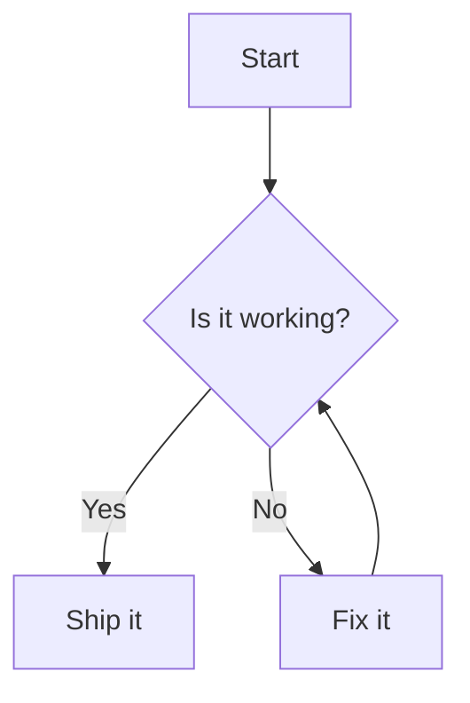

## 安装

> 前置条件：dumi@2.0.0+

:::code-group

```bash [npm]
npm install dumi-plugin-mermaid --save-dev
```

```bash [yarn]
yarn add dumi-plugin-mermaid --dev
```

```bash [pnpm]
pnpm add dumi-plugin-mermaid --save-dev
```

```bash [bun]
bun add dumi-plugin-mermaid --dev
```

:::

<br />

## 使用

```js {3} | pure
// .dumirc.ts
export default {
  plugins: ['dumi-plugin-mermaid'],
};
```

然后在 Markdown 里用 `mermaid` 代码块书写图表：

<pre lang="markdown">

</pre>

## 配置

dumi 的 `plugins` 只接受字符串，需要传选项时用一个本地插件文件包一层：

```js | pure
// .dumi/mermaid-plugin.ts
import { defineMermaidPlugin } from 'dumi-plugin-mermaid';

export default defineMermaidPlugin({
  mermaidConfig: { securityLevel: 'loose' },
});
```

```js {5} | pure
// .dumirc.ts
import { resolve } from 'path';

export default {
  plugins: [resolve(__dirname, './.dumi/mermaid-plugin.ts')],
};
```

> `plugins` 里的相对路径以 dumi 的运行目录（项目根）为基准，而不是 `.dumirc.ts` 所在位置。
> 配置和插件文件不在同一层、或在 monorepo 里从其他目录启动时，用 `resolve(__dirname, ...)` 写成绝对路径更稳妥。

`mermaidConfig` 会作为 `mermaid.initialize` 的参数，**必须是可序列化的 JSON**。

`defaultView` 指定图表面板默认展示的视图，可选 `'preview'`（默认）或 `'code'`：

```js | pure
// .dumi/mermaid-plugin.ts
export default defineMermaidPlugin({ defaultView: 'code' });
```

设为 `'code'` 时首屏只渲染源码，点 Preview 才会加载并渲染 mermaid——适合图表多、
但读者大多只想复制源码的文档站。

## 体积

mermaid 是懒加载的，并且在图表滚动到视口附近（提前一屏）时才开始加载与渲染：

- 页面里没有图表 → 不下载任何 mermaid 代码；
- 图表在首屏外 → 滚动到附近才下载，且多个图表按视口顺序依次渲染，避免长任务。

如果连站点产物里的 mermaid 也不想保留，可以让浏览器直接从 CDN 加载：

```js | pure
// .dumi/mermaid-plugin.ts
import { defineMermaidPlugin } from 'dumi-plugin-mermaid';

export default defineMermaidPlugin({
  runtimeURL: 'https://unpkg.com/mermaid@11/dist/mermaid.esm.min.mjs',
});
```

`runtimeURL` 必须指向 mermaid 的 **ESM 入口**（`dist/mermaid.esm.min.mjs`），它会继续按图类型拆分并按需请求；指向 UMD 产物（如 `mermaid.min.js`）会导致图表加载失败。

地址在构建期注入一次，不会重复写进每个图表的 props；CDN 模式下手工引入 `dumi-plugin-mermaid/component`
也能正常加载。除绝对地址外，还支持协议相对地址（`//cdn.example.com/...`）和站内路径
（如 `/mermaid.esm.min.mjs`，把文件放进 `public/` 即可自托管）。

几个可直接使用的地址：

| 源        | 地址                                                                       |
| --------- | -------------------------------------------------------------------------- |
| unpkg     | `https://unpkg.com/mermaid@11/dist/mermaid.esm.min.mjs`                    |
| jsDelivr  | `https://cdn.jsdelivr.net/npm/mermaid@11/dist/mermaid.esm.min.mjs`         |
| npmmirror | `https://registry.npmmirror.com/mermaid/11/files/dist/mermaid.esm.min.mjs` |

:::warning
CDN 模式会引入外网依赖，内网、离线环境请勿开启；`http://` 地址在 https 站点会被浏览器拦截（构建时会给出警告）。
版本由地址里的 `@11` 决定，不会与插件依赖中的 mermaid 版本联动。
:::

### 渲染细节

- **预加载**：`defaultView: 'code'` 时，鼠标悬停或聚焦到切换按钮会先下载 mermaid（不渲染），点开 Preview 即出图。
- **失败重试**：模块加载失败会自动重试一次；仍失败时图表位置展示源码与错误信息，并提供「重试」按钮。
- **占位高度**：同一份源码再次渲染时，骨架会先占住上次的高度，避免图表出现时页面跳动。
- **无障碍**：切换按钮使用 `role="tablist"` / `role="tab"` 语义，支持左右方向键切换。

## 自定义

<i>Source Code: [src/component](https://github.com/Wxh16144/dumi-plugin-mermaid/tree/master/src/component)</i>

在 `.dumi/theme/builtins/DumiPluginMermaid/index.tsx` 里给出一份自己的实现，即可接管渲染：

```js | pure
// .dumi/theme/builtins/DumiPluginMermaid/index.tsx
export default (props) => {
  return <div>{props.code}</div>;
};
```

#### 切换源码与图表

`dumi-plugin-mermaid/component` 导出以下组件和 Hook：

| 导出            | 说明                                                                        |
| --------------- | --------------------------------------------------------------------------- |
| `default`       | 右上角带切换按钮的图表（等同于 `MermaidToggle`）                            |
| `Mermaid`       | 只渲染图表，图表就绪前显示加载骨架                                          |
| `MermaidSource` | 只渲染 Mermaid 源码                                                         |
| `MermaidToggle` | 等同于默认导出                                                              |
| `useMermaid`    | 渲染 Mermaid 源码并返回 `{ svg, error, loading, retry }`，用于组合自定义 UI |

`Mermaid` 与 `MermaidToggle` 接受 `code`、`mermaidConfig`、`eager` 和可选的 `onRender(svg)`。其中 `svg` 是经过 XML 序列化、可独立使用的 SVG 字符串。`MermaidToggle` 还接受 `defaultView`，可逐实例覆盖插件选项；`runtimeURL` 默认由插件注入，只有需要给单个图表换地址时才需要传。需要在图表渲染完成后生成下载链接、图片预览等内容时，可以使用 `onRender`：

```tsx | pure
import { MermaidToggle } from 'dumi-plugin-mermaid/component';

export default () => (
  <MermaidToggle
    code="graph TD; A --> B;"
    onRender={(svg) => {
      console.log(svg);
    }}
  />
);
```

`eager` 会跳过「进入视口才加载」的优化，挂载即渲染；打印、首屏外必须立即出图的场景可以打开它。

默认导出的组件会渲染图表，点击右上角按钮即可查看源码。想只渲染图表、不带切换按钮时：

```js | pure
// .dumi/theme/builtins/DumiPluginMermaid/index.tsx
export { Mermaid as default } from 'dumi-plugin-mermaid/component';
```

## 限制

仅支持运行时渲染，因此 `rehype-mermaid` 的以下选项不可用：`strategy`（`img-png` / `img-svg` / `inline-svg`）、
`dark`、`colorScheme`、`errorFallback`、`screenshot`、`browser`、`launchOptions`。写在 `::: code-group` 里的图表
会就地渲染，可能与 tab 布局不符。

图表按视口懒渲染，浏览器打印（含导出 PDF）时未滚动到的图表仍是骨架；需要整页打印可以在对应页面使用 `eager`。
